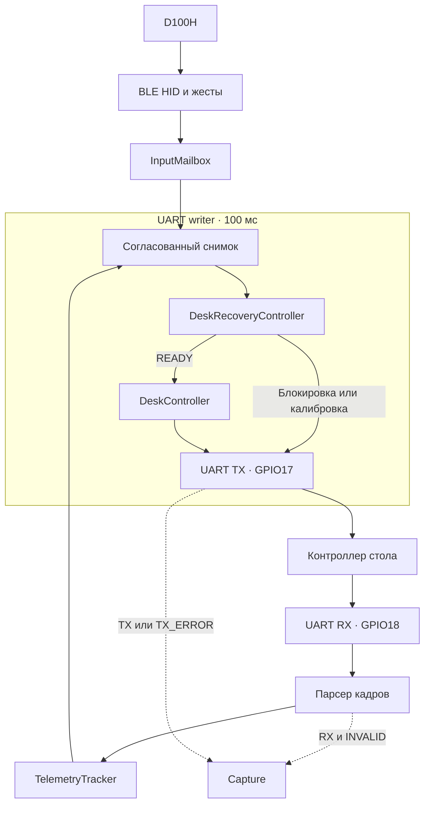
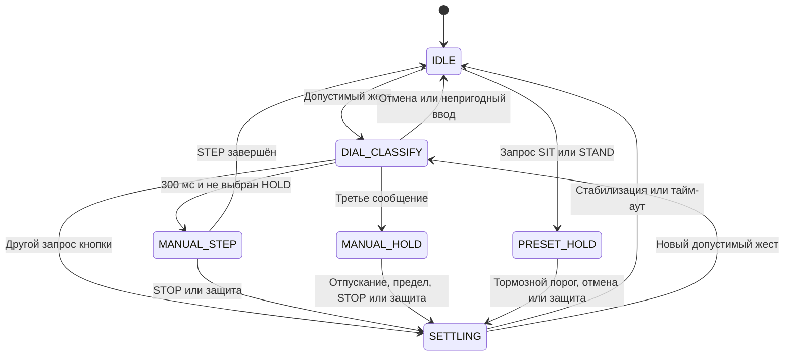
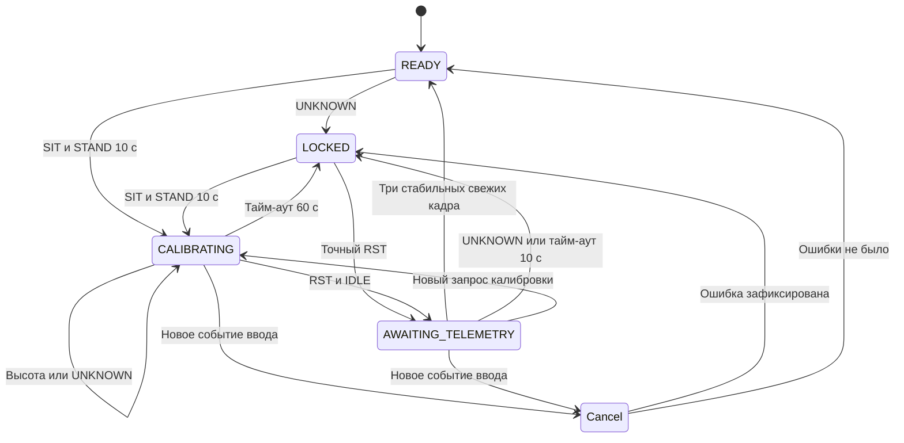
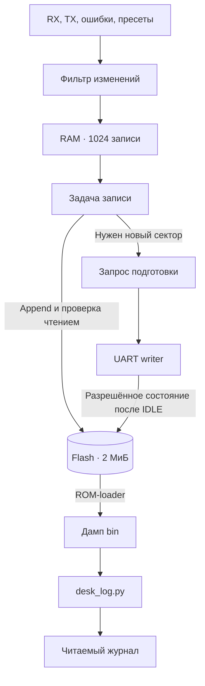

# Архитектура прошивки

Рабочий режим имеет одну задачу передачи команд.
Recovery имеет приоритет над обычным управлением.
Журнал сохраняет решения и обмен UART; он не выбирает движение.

## Поток данных

Сплошные стрелки показывают управление.
Пунктирные стрелки показывают запись истории.
BLE callback изменяет mailbox и не записывает flash.
Writer получает один согласованный снимок ввода и телеметрии на цикл.
Mailbox не содержит очереди будущих движений.

## Модули

Пути в таблице относятся к каталогу firmware.

| Модуль | Ответственность |
|---|---|
| components/desk_protocol | Кадры, контрольная сумма, парсер и классификация ответов |
| components/desk_controller/desk_inputs.cpp | Mailbox, жесты кнопок и допустимость телеметрии |
| components/desk_controller/desk_controller.cpp | Обычное движение, цели, пределы и тайм-ауты |
| components/desk_controller/desk_recovery.cpp | Блокировка и калибровка |
| components/desk_journal | Формат flash, фильтр, очередь и кольцевое хранение |
| main/production_main.cpp | Задачи ESP-IDF и единственный writer |
| main/ble_hid_host.cpp, ble_bonds.cpp | Поиск, HID-ввод, привязки и повторное подключение |
| main/preset_store.cpp | Пресеты NVS |
| main/persistent_journal.cpp | Flash-адаптер и фоновая запись |
| main/journal_motion.hpp | Перевод решений контроллера в стабильные коды причин журнала |
| main/uart_transport.cpp | Настройка UART |
| main/app_main.cpp, lab_hid_trace.cpp | Лабораторные точки входа и HID-вывод |

CMake выбирает одну точку входа.
Чистые компоненты не зависят от ESP-IDF.
Они проверяются на компьютере.
Адаптеры требуют сборки ESP и аппаратной проверки.

## Обычное движение

Схема показывает основные переходы.
Если снимок уже содержит три сообщения, классификация сразу выбирает HOLD.
Готовый SETTLING может принять новый пресет через IDLE в том же цикле.
Параметры определены в [ControllerConfig](../firmware/components/desk_controller/include/desk_controller.hpp).

| Параметр | Значение |
|---|---:|
| Цикл UART-writer | 100 мс |
| Максимальный возраст высоты | 300 мс |
| Окно классификации STEP | 300 мс |
| Порог HOLD | Третье сообщение того же направления |
| Интервал отпускания ручного HOLD | 350 мс |
| Ожидание начала движения | 2500 мс |
| Отсутствие прогресса | 2000 мс |
| Максимум STEP | 5 с |
| Максимум пресетного HOLD | 20 с |
| Максимум ручного HOLD | 30 с |
| Максимум ожидания остановки | 7 с |
| Тишина перед новым жестом | 500 мс |

Обычное управление проверяет свежесть, флаги, статус и физический диапазон высоты.
Непригодные данные запрещают запуск или продолжение движения.
Калибровка не доверяет числовой высоте как условию прекращения DOWN.

## Восстановление

| Состояние | Выход и переход |
|---|---|
| READY | Работает обычный контроллер. UNKNOWN переводит в LOCKED. |
| LOCKED | Передаётся IDLE. Калибровка запускает DOWN; точный RST запускает ожидание высоты. |
| CALIBRATING | Передаётся DOWN_HOLD до RST, отмены или тайм-аута. UNKNOWN не прекращает DOWN. |
| AWAITING_TELEMETRY | Передаётся IDLE. Три стабильных свежих кадра возвращают READY. |

Recovery отменяет активную цель обычного автомата.
Запрос калибровки запускает новый отсчёт её тайм-аута.
Обычная высота в LOCKED не снимает блокировку.
Защёлка ошибки находится в RAM.
Журнал не восстанавливает эту защёлку после перезапуска.

## Хранение

NVS хранит пресеты и привязку Bluetooth.
Отдельный раздел desk_log хранит журнал.
PRESETS фиксирует рабочие значения при запуске.
SAVE фиксирует успешное изменение после NVS commit.
Ограничения общей транзакции описаны в [формате хранения](persistent-journal.md).

Источник IDLE берётся до смены состояния управления.
Поэтому отмена пресета сохраняет SIT или STAND.
Причина хранится в старших битах context той же 32-байтовой записи.
Новая значимая причина сохраняется один раз даже после скрытого IDLE импульса STEP.
Обычное завершение STEP не создаёт отдельного события.

## Синхронизация и надзор

Один lock защищает согласованный снимок mailbox и телеметрии.
Другой lock защищает очередь журнала.
Mutex сериализует доступ фоновой задачи и writer к Store.
В критической секции не выполняются UART I/O, NVS или flash I/O.

При UNKNOWN запись новых событий ждёт обработки соответствующего снимка writer.
Стирание выполняет writer только после успешного IDLE в разрешённом состоянии.
Writer не запускает HOLD одновременно со своим стиранием.
Программирование flash может задерживать задачи; измерения этой задержки остаются открытыми.

Supervisor проверяет успешные передачи writer раз в секунду.
После трёх пропусков он перезапускает ESP.
Это не доказательство физической остановки при исчезновении UART.
Рабочая консоль и RTC-диагностика отсутствуют.
Действующие испытания приведены в [плане проверки](verification-plan.md).
