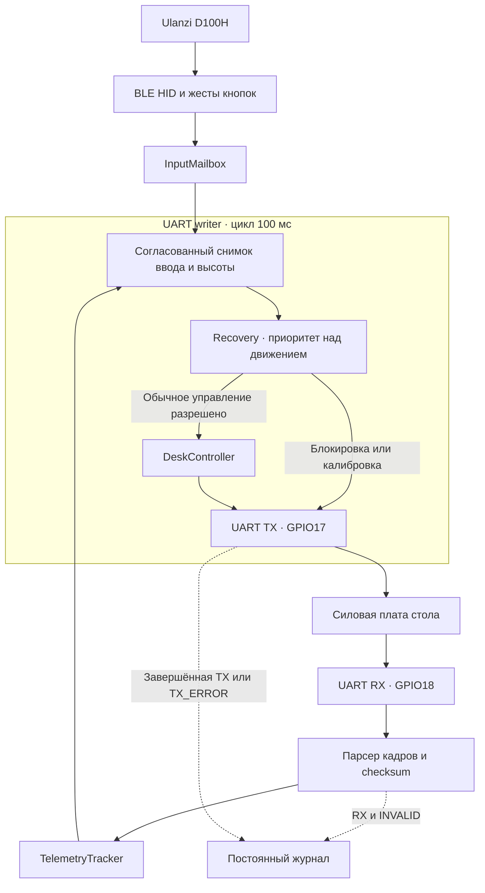
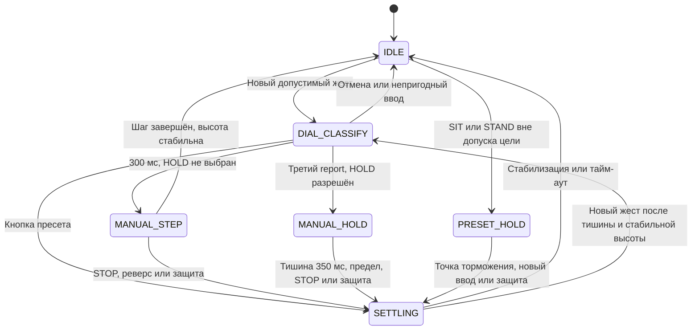
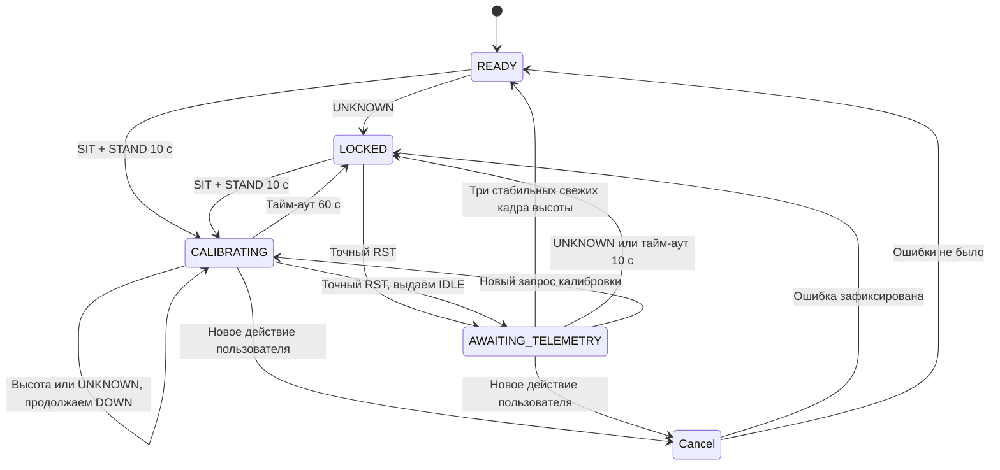
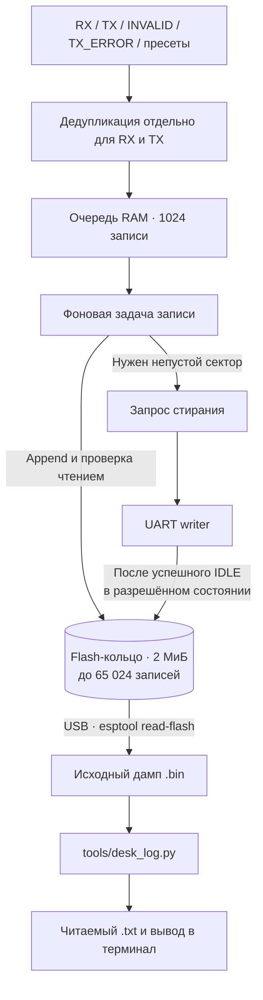

# Архитектура прошивки

Сплошные стрелки показывают путь управления, пунктирные — диагностику.
Журнал не принимает решений о движении.

## Границы модулей

| Модуль | Ответственность |
|---|---|
| `components/desk_protocol` | Восьмибайтовые кадры, checksum, потоковый парсер, классификация ответов |
| `components/desk_controller/desk_inputs.cpp` | Снимок BLE-ввода и пригодность телеметрии |
| `components/desk_controller/desk_controller.cpp` | Обычное движение, цели, пределы, выбег и тайм-ауты |
| `components/desk_controller/desk_recovery.cpp` | Блокировка, калибровка, ожидание высоты после RST |
| `components/desk_journal` | Формат записей, дедупликация, очередь и flash-кольцо без зависимости от ESP-IDF |
| `main/production_main.cpp` | Задачи и синхронизация production; единственный writer команд |
| `main/ble_hid_host.cpp`, `ble_bonds.cpp` | HID, жесты кнопок, поиск и привязки |
| `main/preset_store.cpp` | Чтение и сохранение SIT/STAND в NVS |
| `main/uart_transport.cpp` | Настройка UART |
| `main/persistent_journal.cpp` | ESP flash-адаптер и фоновая запись |
| `main/app_main.cpp`, `lab_hid_trace.cpp` | Лабораторные режимы; live-HID вывод не включается в production |

CMake выбирает одну точку входа. Чистые компоненты проверяются host-тестами;
ESP-адаптеры требуют сборки и аппаратной проверки.

## Обычное движение

Схема показывает основные переходы. Если в одном снимке уже есть три reports,
классификация может сразу перейти в HOLD без отдельного цикла ожидания.
Готовый к работе `SETTLING` также может принять новый пресет через `IDLE`
в том же цикле. Защита включает проверку телеметрии, прогресса и тайм-аутов.
Вмешательство recovery показано отдельно ниже.

Состояния: `IDLE`, `DIAL_CLASSIFY`, `MANUAL_STEP`, `MANUAL_HOLD`,
`PRESET_HOLD`, `SETTLING`. На каждом цикле writer получает согласованный
снимок времени, телеметрии и ввода. Команды не накапливаются в очередь.
Параметры задаёт `ControllerConfig` в
[desk_controller.hpp](../firmware/components/desk_controller/include/desk_controller.hpp).

| Параметр | Значение |
|---|---:|
| Цикл передачи UART | 100 мс |
| Свежесть телеметрии | 300 мс |
| Классификация одиночного жеста | 300 мс, HOLD с третьего report |
| Продление ручного HOLD | 350 мс после последнего report |
| Ожидание начала движения | 2500 мс |
| Отсутствие прогресса | 2000 мс |
| Максимум STEP / preset HOLD / manual HOLD | 5 / 20 / 30 с |
| Максимум стабилизации | 7 с |
| Тишина перед следующим жестом | 500 мс |

Проверяются свежесть, флаги, статус и физический диапазон высоты.
Непригодная телеметрия запрещает обычное движение. Калибровка имеет отдельную
политику, поскольку при ошибке высота может быть неверна.
Пределы, пресеты и жесты описаны в [управлении](ulanzi-d100h.md).

## Восстановление

`LOCKED` и `AWAITING_TELEMETRY` продолжают отправлять IDLE.
Запрос калибровки имеет приоритет и запускает новый отсчёт её тайм-аута.
Обычная высота в `LOCKED` не снимает блокировку.

| Состояние | Выход и условие перехода |
|---|---|
| `READY` | Работает обычный контроллер; UNKNOWN переводит в LOCKED |
| `LOCKED` | IDLE; жест калибровки запускает DOWN, точный RST переводит в ожидание высоты |
| `CALIBRATING` | DOWN_HOLD до RST, отмены или 60 с; UNKNOWN не прерывает спуск |
| `AWAITING_TELEMETRY` | IDLE; три стабильных свежих кадра снимают блокировку; новая ошибка или 10 с ожидания возвращают LOCKED |

Recovery имеет приоритет над обычным движением и сбрасывает его активную цель.
Отмена при зафиксированной ошибке сохраняет LOCKED. Защёлка ошибки находится
в RAM; журнал хранит историю, но не восстанавливает блокировку при загрузке.

## Хранение и отказоустойчивость

Стирание не выполняется параллельно запуску HOLD тем же writer.
Программирование flash остаётся фоновой операцией и может задерживать задачи;
его влияние на STOP ещё требует измерения. При UNKNOWN новые записи ждут
обработки соответствующего снимка writer; уже начатая flash-операция не отменяется.
Очередь в RAM — временный буфер: её незаписанный хвост может пропасть при
снятии питания. Подробнее — [формат и сохранность журнала](persistent-journal.md).

NVS хранит пресеты и BLE bond. Отдельный раздел flash хранит
[постоянный журнал](persistent-journal.md): при старте — текущие пресеты,
после успешной перезаписи — прежние и новые значения. RTC-диагностика удалена.
Production не содержит печати кадров, состояний и BLE-событий в консоль;
консоль и платформенные логи отключены в конфигурации сборки.

Supervisor раз в секунду проверяет успешные передачи writer и после трёх
пропусков перезапускает ESP. Это не доказательство мгновенной остановки
силовой платы при исчезновении UART. Реакция механики и задержки flash
проверяются отдельно по [плану испытаний](verification-plan.md).
